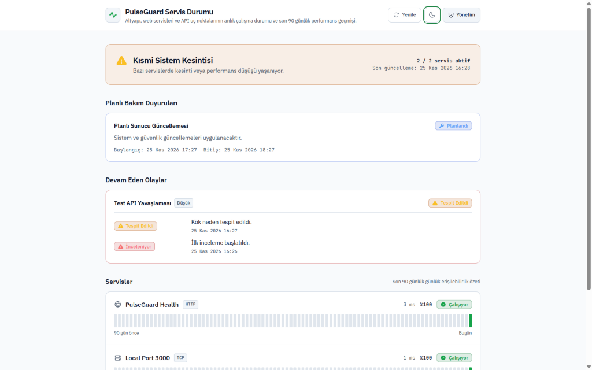
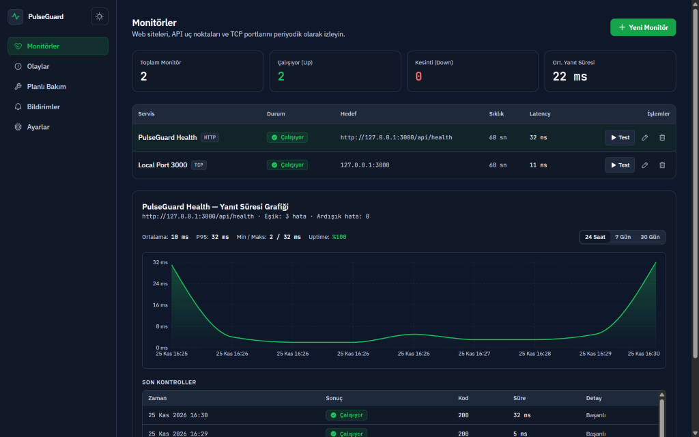

# PulseGuard — Self-Hosted Uptime & Incident Monitor

PulseGuard; web sitelerini, API uç noktalarını ve TCP portlarını periyodik olarak izleyen, yanıt sürelerini (latency) grafiklerle görselleştiren, ardışık 3 başarısız kontrolde kesinti bildirimi gönderen ve son 90 günlük çalışma geçmişini sunan tek sunuculu (self-hosted), tek yöneticili bir **Uptime & Incident Monitor** uygulamasıdır.

## Ekran Görüntüleri

### Public Status Page (90 Günlük Çalışma Geçmişi, Olay & Bakım Duyuruları)


### Yönetim Paneli (Monitörler & Yanıt Süresi Grafiği)


---

## Temel Özellikler

- **Çoklu Kontrol Tipleri:** Website (`HTTP/HTTPS`), `API Endpoint` (özel metot, header, beklenen HTTP durum kodu ve yanıt gövdesi anahtar kelime doğrulaması) ve `TCP Port` (`host:port`) izleme.
- **3 Ardışık Hata Eşiği & Tek Seferlik Bildirim:** Bir servis üst üste 3 kez yanıt veremediğinde durumu otomatik olarak `Down` yapar, olay (incident) kaydı açar ve **Telegram / Discord / Webhook (HMAC-SHA256)** üzerinden tek bildirim gönderir. Servis düzeldiğinde olayı kapatır ve tek seferlik `Up` bildirimi atar.
- **Public Status Page (`/`):**
  - Genel sistem durumu bandı (*Tüm Sistemler Çalışıyor / Kısmi Kesinti / Büyük Kesinti / Planlı Bakım*).
  - Her servis için son **90 günlük** erişilebilirlik çubukları, günlük uptime yüzdesi ve ortalama latency tooltip'leri.
  - Otomatik ve manuel **Olay Zaman Çizelgesi** (*İnceleniyor → Tespit Edildi → İzleniyor → Çözüldü*) ile **Planlı Bakım** duyuruları.
  - Koyu (varsayılan) ve açık tema desteği.
- **Tek Yönetici Paneli (`/admin`):**
  - `scrypt` parola hash'leme, `SHA-256` özetli `HttpOnly` oturum çerezi ve login rate limiter.
  - `24 Saat / 7 Gün / 30 Gün` yanıt süresi grafikleri (Ortalama, P95, Min/Maks, Uptime).
  - Anlık kontrol ("Test"), manuel olay/bakım yönetimi ve bildirim kanalı test gönderimi.

---

## Teknoloji Yığını ve Belgeler

- **Backend:** Node.js (v24+), TypeScript, [Hono](https://hono.dev/), yerleşik `node:sqlite` (WAL modu), Zod
- **Frontend:** React 19, Vite, Tailwind CSS v4, Recharts, Phosphor Icons
- **Mimari & Tasarım Belgeleri:**
  - Mimari kararlar, veri modeli ve güvenlik kuralları: [`ARCHITECTURE.md`](ARCHITECTURE.md)
  - Görsel tasarım sistemi ve erişilebilirlik rehberi: [`DESIGN.md`](DESIGN.md)

---

## Kurulum ve Çalıştırma

### Seçenek 1: Yerelde Çalıştırma (Node.js 24+)

> **Windows PowerShell Notu:** PowerShell güvenlik ilkesi `npm.ps1` betiğini engelliyorsa `npm` yerine **`npm.cmd`** kullanın.

```bash
# 1. Bağımlılıkları yükleyin
npm.cmd install   # Linux/macOS için: npm install

# 2. (İsteğe bağlı) Ortam değişkenlerini ayarlayın
cp .env.example .env

# 3. Frontend ve Backend'i derleyin
npm.cmd run build # Linux/macOS için: npm run build

# 4. Sunucuyu başlatın
npm.cmd start     # veya doğrudan: node server/dist/index.js
```

Tarayıcıdan açın:
- **Public Status Page:** `http://localhost:3000`
- **Yönetim Paneli (ilk açılışta tek yönetici kurulum ekranı açılır):** `http://localhost:3000/admin`

### Seçenek 2: Docker ile Self-Hosted Çalıştırma

```bash
cp .env.example .env
docker compose up -d --build
```

Veritabanı dosyaları `./data` klasöründe kalıcı olarak saklanır.

---

## Ortam Değişkenleri (`.env`)

| Değişken | Varsayılan | Açıklama |
|---|---|---|
| `PORT` | `3000` | HTTP sunucu portu |
| `DATA_DIR` | `./data` | SQLite veritabanı klasörü |
| `ADMIN_EMAIL` | *(boş)* | İlk açılışta otomatik yönetici oluşturmak için e-posta (boşsa `/admin/login` üzerinden kurulur) |
| `ADMIN_PASSWORD` | *(boş)* | İlk açılış yönetici parolası (en az 8 karakter) |
| `COOKIE_SECURE` | `false` | HTTPS arkasında dağıtırken `true` yapın |
| `ALLOW_PRIVATE_TARGETS` | `true` | Yerel/özel IP hedeflerinin (`localhost`, `192.168.x.x` vb.) izlenmesine izin verir |
| `CHECK_RETENTION_DAYS` | `30` | Ham kontrol kayıtlarının saklanma süresi (gün) |

---

## Test ve Doğrulama

```bash
npm.cmd run typecheck
npm.cmd test
```
